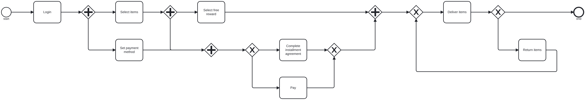
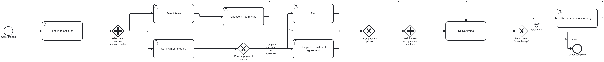
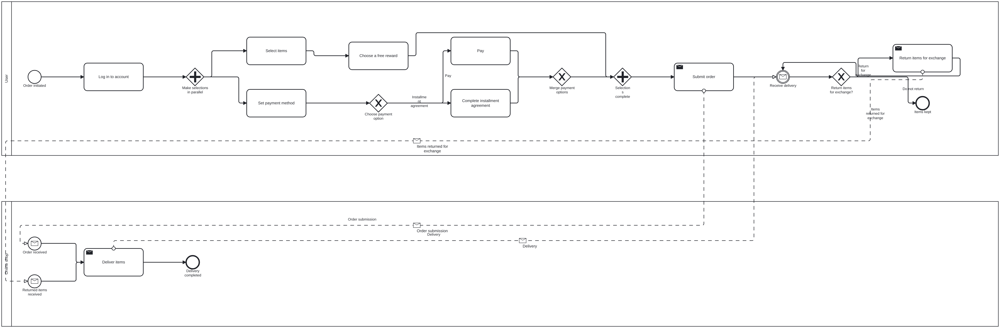
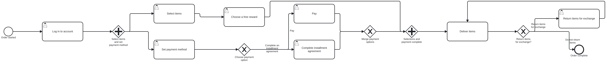
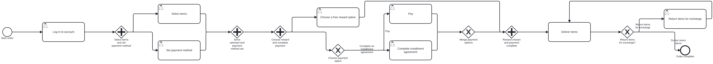
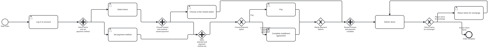
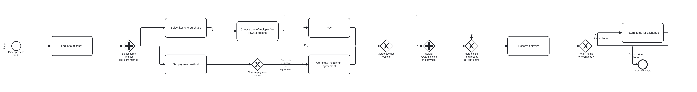

# Scenario 1: description 19 with GPT-6 Luna

**Description** (PMo dataset, id 19; reference model: one process, no pools or lanes):

> Consider a process for purchasing items from an online shop.
The user starts an order by logging in to their account.
Then, the user simultaneously selects the items to purchase and sets a payment method.
Afterward, the user either pays or completes an installment agreement.
After selecting the items, the user chooses between multiple options for a free reward.
Since the reward value depends on the purchase value, this step is done after selecting the items, but it is independent of the payment activities.
Finally, the items are delivered.
The user has the right to return items for exchange.
Every time items are returned, a new delivery is made.

This scenario follows the same description through the three settings of the paper. Each stage below
shows the model GuideBPMN generated, with its open errors (T1–T7, lower is better) and its similarity
to the reference model (in %, higher is better).

| Stage | Errors | Activities F1 | Connections F1 | Flow order | Coverage |
|---|---|---|---|---|---|
| First (documentation guidelines only) | 12 | 100.0 | 68.4 | 80.0 | 83.3 |
| Revised: first draft (round 0) | 21 | 94.1 | 52.4 | 61.4 | 65.0 |
| Revised: iteration 1 | 12 | 100.0 | 68.4 | 80.0 | 83.3 |
| Revised: iteration 2 | 11 | 100.0 | 73.2 | 90.9 | 94.4 |
| Revised: iteration 3 (Learned) | 5 | 100.0 | 87.8 | 94.4 | 94.4 |
| Reuse (guidelines learned on other descriptions) | 7 | 100.0 | 82.1 | 85.9 | 88.9 |

## Reference model (gold BPMN of the dataset)

## First: documentation guidelines only

The generator receives the description and the 82 documentation guidelines. This is the First run
whose number of errors is the median of the three First runs (`batch_20261117T040625Z_openai-gpt-6-luna_documentation_r3`). Model: one process, no pools or lanes.

## Revised: three iterations with error-driven guidelines

Run `batch_20261117T232224Z_openai-gpt-6-luna_documentation_forced_r2_agents`. The run starts with its own first draft (21 errors). After each draft,
the guideline agents turn the detected errors into guidelines, and the generator revises the model with them.
The errors go from 21 to 12, 11 and 5.

**First draft** (21 errors; 2 pools, 3 message flows):

**Iteration 1** (12 errors):

**Iteration 2** (11 errors):

**Iteration 3, the Learned model** (5 errors; one process, no pools or lanes):

An iteration whose new model has more errors is not kept: the stage then shows the model kept before it.

### Guidelines learned on this description

**Learned after the first draft** (sent to iteration 1):

- **LRN-027** (T5, consolidated with an existing guideline, refines FID-01; confirmed: yes): *When the description explicitly states an activity that occurs only under a condition or as part of a repeated cycle:* Model the activity on the applicable conditional branch or in the repeated flow, preserving its stated place and dependencies in the process.
- **LRN-033** (T6, new generic guideline, refines ACT-04; confirmed: yes): *When the description says that goods or services are delivered but does not describe sending a message to another participant:* Model the delivery as a generic task, not a send task.

**Learned after iteration 1** (sent to iteration 2):

- **LRN-034** (T5, new generic guideline, new; confirmed: yes): *When the description says an optional activity may occur after a later activity, and that each occurrence causes that later activity to happen again:* Model the optional activity on a conditional return path to the later activity, while preserving the path that continues without the optional activity.

## Reuse: guidelines learned on other descriptions

Run `batch_20261118T190009Z_openai-gpt-6-luna_documentation_learned_confirmed_fold4_agents` (cross-validation round 4). The generator received the documentation
guidelines and the 37 confirmed generic guidelines learned on the 44 descriptions of the
other four folds. The reference model of this description was not used. Errors: 7, fewer errors than First (12).

## Files

- `description.txt`: the process description.
- `0_reference.bpmn`: the reference model; `1_first.bpmn` to `6_reuse.bpmn`: the generated models.
  The generator does not write diagram positions; a layout was added to these copies so that they open in any
  BPMN editor (elements and flows are unchanged). The XML exactly as generated is in the run folder
  `bpmn_pipeline/runs/<run>/id_19/round_N/`.
- The `.png` files: the diagrams above.
