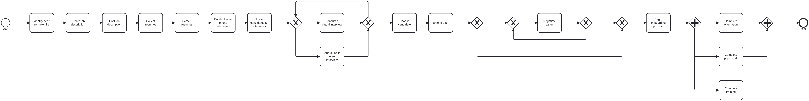
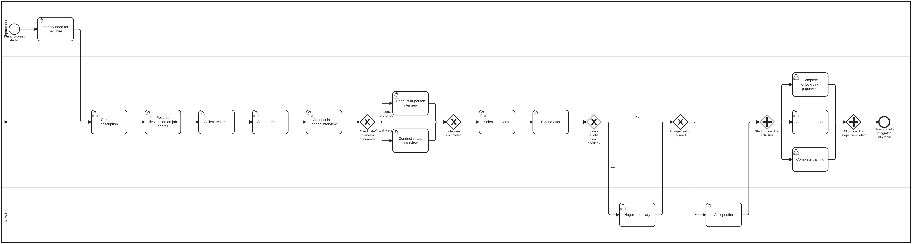
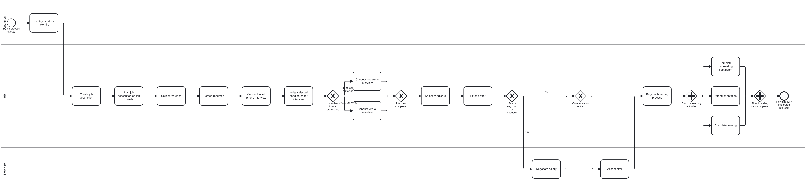
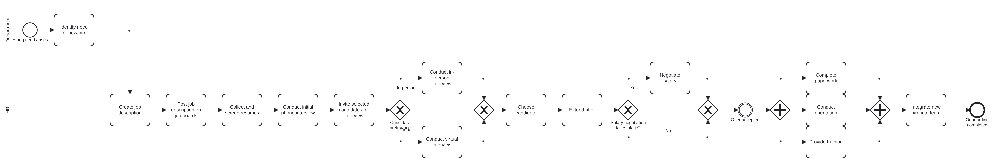

# Scenario 2: description 02 with Claude Haiku 5.5

**Description** (PMo dataset, id 02; reference model: one process, no pools or lanes):

> This process kicks off when a department identifies the need for a new hire.
HR creates a job description and posts it on job boards.
Resumes are collected and screened, followed by initial phone interviews.
Selected candidates are invited for in-person or virtual interviews depending on each candidate's preference.
Once a candidate is chosen, an offer is extended, and salary negotiations may take place.
After the offer is accepted, the onboarding process begins, including paperwork, orientation, and training.
The process concludes once all onboarding steps are completed and the new hire is fully integrated into the team.

This scenario follows the same description through the three settings of the paper. Each stage below
shows the model GuideBPMN generated, with its open errors (T1–T7, lower is better) and its similarity
to the reference model (in %, higher is better).

| Stage | Errors | Activities F1 | Connections F1 | Flow order | Coverage |
|---|---|---|---|---|---|
| First (documentation guidelines only) | 33 | 90.3 | 46.4 | 62.5 | 73.1 |
| Revised: first draft (round 0) | 32 | 86.7 | 46.2 | 65.7 | 69.2 |
| Revised: iteration 1 | 18 | 90.3 | 73.7 | 82.1 | 84.6 |
| Revised: iteration 2 | 12 | 97.0 | 81.4 | 90.0 | 92.3 |
| Revised: iteration 3 (Learned) | 12 | 97.0 | 81.4 | 90.0 | 92.3 |
| Reuse (guidelines learned on other descriptions) | 19 | 96.8 | 69.0 | 78.6 | 84.6 |

## Reference model (gold BPMN of the dataset)

## First: documentation guidelines only

The generator receives the description and the 82 documentation guidelines. This is the First run
whose number of errors is the median of the three First runs (`batch_20261117T040632Z_anthropic-claude-haiku-5-5_documentation_r2`). Model: 2 lanes.

## Revised: three iterations with error-driven guidelines

Run `batch_20261117T232231Z_anthropic-claude-haiku-5-5_documentation_forced_r1_agents`. The run starts with its own first draft (32 errors). After each draft,
the guideline agents turn the detected errors into guidelines, and the generator revises the model with them.
The errors go from 32 to 18, 12 and 12.

**First draft** (32 errors; 2 lanes):

**Iteration 1** (18 errors):

**Iteration 2** (12 errors):

**Iteration 3, the Learned model** (12 errors; 2 lanes):

An iteration whose new model has more errors is not kept: the stage then shows the model kept before it.

### Guidelines learned on this description

**Learned after the first draft** (sent to iteration 1):

- **EXS-003** (T5, new example-specific guideline, new; confirmed: yes): *When the description says the process kicks off when a participant performs an action or identifies a need (for example, 'kicks off when a department identifies the need'), so the action itself is something a participant does rather than a received message:* Model a plain start event whose name does not repeat the described action or its result. Place a task for that described action directly after the start event and before the activities that follow it. Do not let the start event itself stand for the action.
- **LRN-003** (T6, new generic guideline, refines ACT-07; confirmed: yes): *When the description names several activities that must all be finished before the process moves on or ends, and it gives no order among them:* Model a parallel gateway that splits into those activities as concurrent branches, and a second parallel gateway that joins the branches before the next element or the end event. Do not chain the activities in a fixed sequence, and do not join them with an exclusive gateway.

**Learned after iteration 1** (sent to iteration 2):

- **LRN-005** (T5, new generic guideline, refines FID-01; confirmed: yes): *When the description states a named action that is performed right after a choice or acceptance outcome (for example, a selected or agreed result) and before a further phase, a branch or a parallel start begins, even when that action is only a short phrase such as an invitation or the beginning of a phase:* Model that stated action as a task placed directly after the step or gateway that produces the outcome, with a sequence flow from that outcome into the task and a sequence flow from the task to the next element the description names. Do not drop the action or let the gateway or the following phase stand for it.
- **LRN-006** (T6, new generic guideline, new; confirmed: yes): *When The description states that an activity may or may not take place (an optional step) and that the flow then continues to a common next step, so a decision gateway with a bypass branch is needed:* Model the optional activity after a decision gateway, with one flow into the activity and one bypass flow that skips it. Place an exclusive merge gateway after the activity that joins the completed-activity flow and the bypass flow, and connect its single outgoing flow to the next step. Do not send the bypass flow directly into the next step, and do not leave the decision gateway without a matching merge.

**Learned after iteration 2** (sent to iteration 3):

- **LRN-006** (T5, consolidated with an existing guideline, new; confirmed: yes): *When The description states that an activity may or may not take place (an optional step) and that the flow then continues to a common next step, so a decision gateway with a bypass branch is needed:* Model the optional activity after a decision gateway, with one flow into the activity and one bypass flow that skips it. Place an exclusive merge gateway after the activity that joins the completed-activity flow and the bypass flow, and connect its single outgoing flow to the next step. Do not send the bypass flow directly into the next step, and do not leave the decision gateway without a matching merge.

## Reuse: guidelines learned on other descriptions

Run `batch_20261119T014852Z_anthropic-claude-haiku-5-5_documentation_learned_confirmed_fold3_agents` (cross-validation round 3). The generator received the documentation
guidelines and the 60 confirmed generic guidelines learned on the 44 descriptions of the
other four folds. The reference model of this description was not used. Errors: 19, fewer errors than First (33).

## Files

- `description.txt`: the process description.
- `0_reference.bpmn`: the reference model; `1_first.bpmn` to `6_reuse.bpmn`: the generated models.
  The generator does not write diagram positions; a layout was added to these copies so that they open in any
  BPMN editor (elements and flows are unchanged). The XML exactly as generated is in the run folder
  `bpmn_pipeline/runs/<run>/id_02/round_N/`.
- The `.png` files: the diagrams above.
