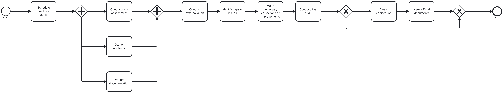
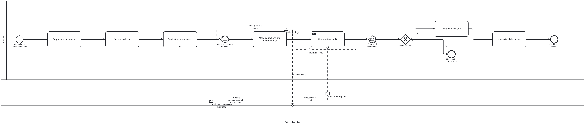
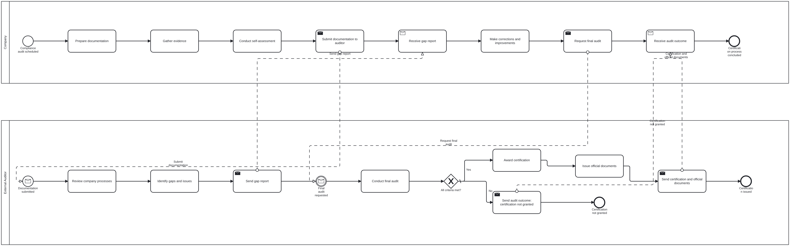
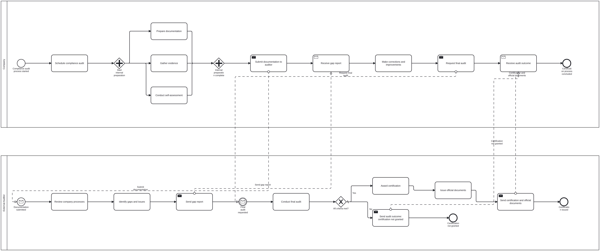
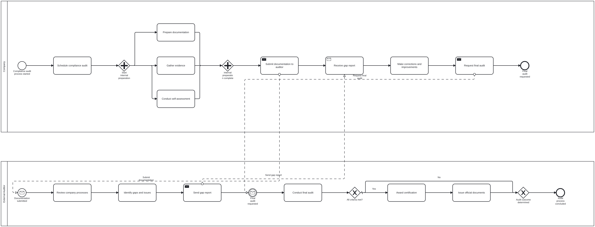
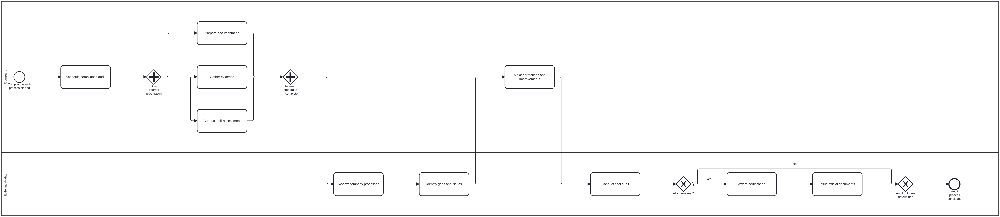
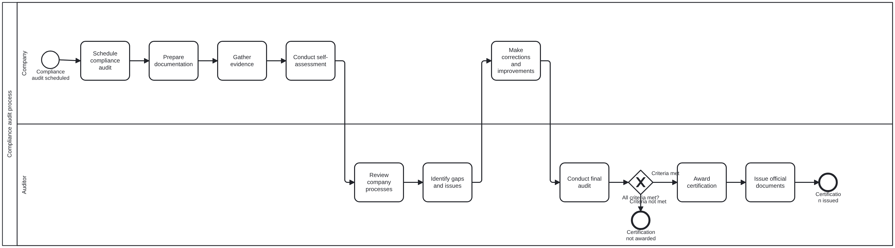

# Scenario 3: description 15 with Claude Haiku 5.5

**Description** (PMo dataset, id 15; reference model: one process, no pools or lanes):

> The process starts when a company schedules a compliance audit for regulations such as ISO standards, safety protocols, or environmental guidelines.
Internal teams prepare documentation, gather evidence, and conduct a self-assessment before the external audit.
Auditors review the company's processes and identify any gaps or issues.
After making the necessary corrections or improvements, the company undergoes a final audit.
If all criteria are met, the company is awarded certification, and the process concludes with the issuance of official documents.

This scenario follows the same description through the three settings of the paper. Each stage below
shows the model GuideBPMN generated, with its open errors (T1–T7, lower is better) and its similarity
to the reference model (in %, higher is better).

| Stage | Errors | Activities F1 | Connections F1 | Flow order | Coverage |
|---|---|---|---|---|---|
| First (documentation guidelines only) | 27 | 82.4 | 20.0 | 48.4 | 56.2 |
| Revised: first draft (round 0) | 41 | 69.2 | 15.4 | 17.9 | 47.8 |
| Revised: iteration 1 | 29 | 74.1 | 50.0 | 36.7 | 57.7 |
| Revised: iteration 2 | 18 | 83.3 | 66.7 | 36.8 | 69.6 |
| Revised: iteration 3 (Learned) | 6 | 90.0 | 88.9 | 93.8 | 93.8 |
| Reuse (guidelines learned on other descriptions) | 21 | 90.0 | 38.7 | 69.3 | 75.0 |

## Reference model (gold BPMN of the dataset)

## First: documentation guidelines only

The generator receives the description and the 82 documentation guidelines. This is the First run
whose number of errors is the median of the three First runs (`batch_20261117T040632Z_anthropic-claude-haiku-5-5_documentation_r2`). Model: 2 pools, 4 message flows.

## Revised: three iterations with error-driven guidelines

Run `batch_20261117T232235Z_anthropic-claude-haiku-5-5_documentation_forced_r2_agents`. The run starts with its own first draft (41 errors). After each draft,
the guideline agents turn the detected errors into guidelines, and the generator revises the model with them.
The errors go from 41 to 29, 18 and 6.

**First draft** (41 errors; 2 pools, 5 message flows):

**Iteration 1** (29 errors):

**Iteration 2** (18 errors):

**Iteration 3, the Learned model** (6 errors; one process, no pools or lanes):

An iteration whose new model has more errors is not kept: the stage then shows the model kept before it.

### Guidelines learned on this description

**Learned after the first draft** (sent to iteration 1):

- **LRN-029** (T5, consolidated with an existing guideline, refines EVT-01; confirmed: yes): *When the description says the process begins with an action performed by an actor, such as a person signing up, and that action is itself described as work the actor performs:* Model a plain start event with no incoming flow, followed by a task that represents the performed action. Do not place the performed action on the start event itself. The task then leads into the subsequent steps.
- **LRN-011** (T6, consolidated with an existing guideline, refines GW-04; confirmed: yes): *When the description lists two or more activities that are performed without a stated order and must all be completed before a later step begins:* Model a parallel gateway that splits into one outgoing branch per listed activity, and a parallel gateway that joins those branches before the next step. Do not chain the activities in sequence, and do not use an exclusive gateway for them.

**Learned after iteration 1** (sent to iteration 2):

- **LRN-036** (T5, new generic guideline, refines PROC-04; confirmed: yes): *When the description states a conditional check after an activity, the positive branch leads to a final activity and the process concludes, and the description names no separate outcome, notification or end for the other branch:* Model the conditional check as an exclusive gateway. Route each branch to a shared exclusive merge gateway placed before one end event, and do not add send tasks or additional end events for outcomes the description does not state.
- **LRN-037** (T6, new generic guideline, refines ACT-07; confirmed: yes): *When the description states a condition that decides whether the process continues to a further outcome or ends, for example 'if all criteria are met, ...' followed by a consequence:* Model an exclusive gateway at the point where the condition is decided, with one labeled outgoing sequence flow for each outcome the description states. Place the gateway before the outcome that the condition governs, and do not leave the conditional outcome as an unconditional sequence of tasks.

**Learned after iteration 2** (sent to iteration 3):

- **LRN-038** (T5, new generic guideline, refines FID-02; confirmed: yes): *When the description lists a stated activity that is followed by a later stated activity, and no message, signal, timer or condition is mentioned between the two activities:* Connect the two activities with a direct sequence flow from the earlier activity to the later one, in the order the description gives. Do not insert a send task, an intermediate catch event, or a gateway between them unless the description explicitly states sending a message or waiting for an event or condition.
- **LRN-039** (T6, new generic guideline, new; confirmed: yes): *When the description states a step with a plain action verb and object for a party, and mentions no request, submission, sending, or message for that step, while a generated task label for that step adds such a communication verb:* Model a plain task whose label reuses the description's own verb and object for that step. Do not add a communication verb such as request, submit, or send to the label, and do not turn the task into a send task or receive task unless the description states a message or sending for that step.

## Reuse: guidelines learned on other descriptions

Run `batch_20261119T014852Z_anthropic-claude-haiku-5-5_documentation_learned_confirmed_fold3_agents` (cross-validation round 3). The generator received the documentation
guidelines and the 60 confirmed generic guidelines learned on the 44 descriptions of the
other four folds. The reference model of this description was not used. Errors: 21, fewer errors than First (27).

## Files

- `description.txt`: the process description.
- `0_reference.bpmn`: the reference model; `1_first.bpmn` to `6_reuse.bpmn`: the generated models.
  The generator does not write diagram positions; a layout was added to these copies so that they open in any
  BPMN editor (elements and flows are unchanged). The XML exactly as generated is in the run folder
  `bpmn_pipeline/runs/<run>/id_15/round_N/`.
- The `.png` files: the diagrams above.
