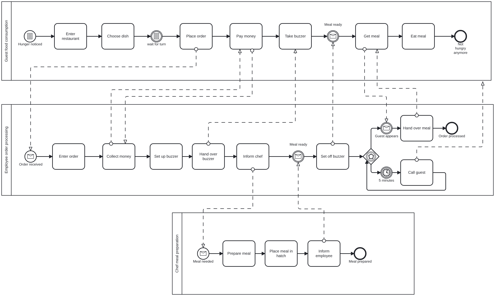
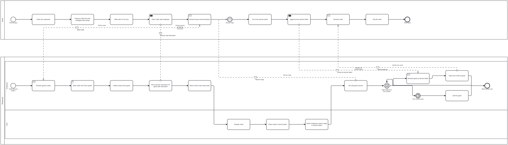
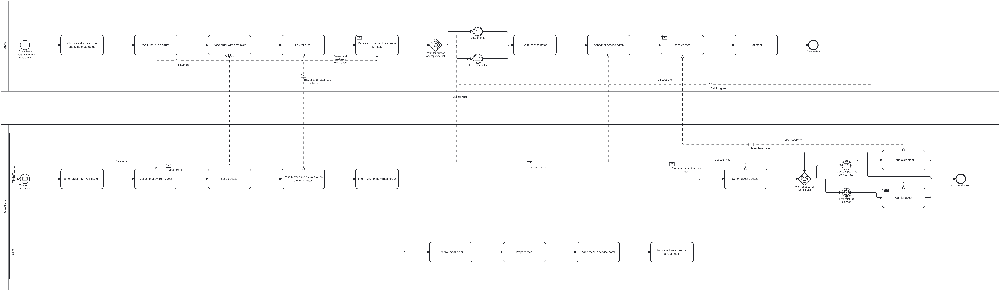
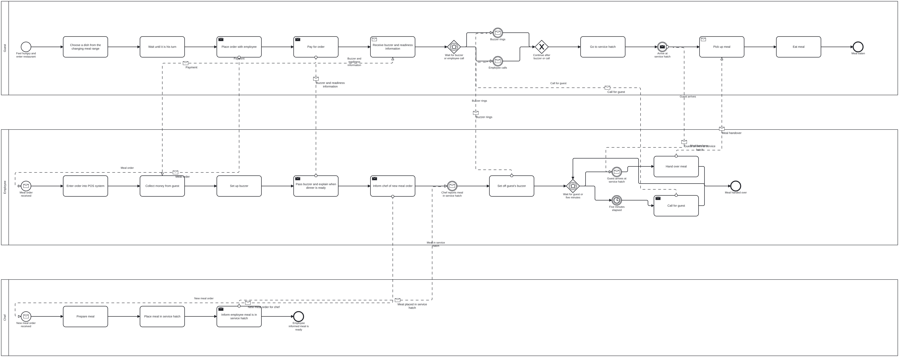
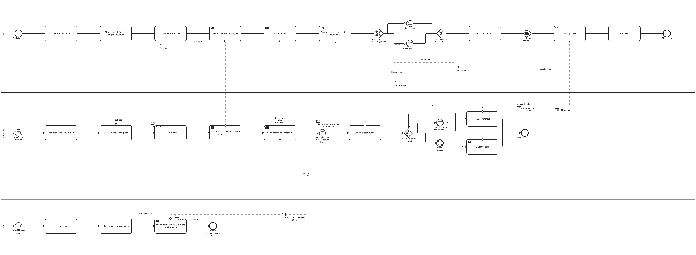
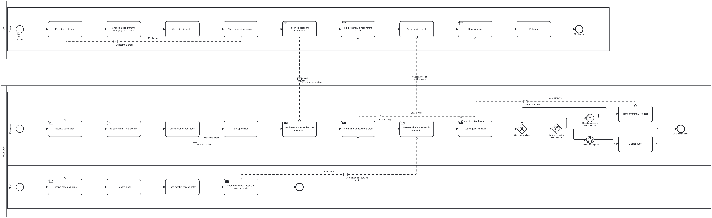

# Scenario 4: description 24 with GPT-6 Luna

**Description** (PMo dataset, id 24; reference model: 3 pools, 10 message flows):

> A guest enters the restaurant when feeling hungry. 
He chooses a dish from the changing meal range and waits until it is his turn. 
Following this he places his order with the employee. The employee enters the order into the POS system and collects the money from the guest. 
After the payment, the employee sets up a buzzer and passes it on to the guest with the following information: 
"When the buzzer rings, your dinner is ready". 
Afterwards the employee informs the chef of the new meal order. 
The chef prepares the meal and places it in the service hatch. 
He then informs the employee that he has placed the finished meal in the service hatch. 
As soon as the employee is aware that the meal is ready he sets off the guest's buzzer. 
This is how the guest finds out that his meal is ready for collection. 
He can pick up his meal and eat it. 
As soon as the guest appears at the service hatch, the employee hands over his meal. 
Should a guest not react to the buzzer, the employee calls for him after 5 minutes, if necessary several times in a row.

This scenario follows the same description through the three settings of the paper. Each stage below
shows the model GuideBPMN generated, with its open errors (T1–T7, lower is better) and its similarity
to the reference model (in %, higher is better; Participants compares pools, lanes, lane membership and message flows).

| Stage | Errors | Activities F1 | Connections F1 | Flow order | Coverage | Participants |
|---|---|---|---|---|---|---|
| First (documentation guidelines only) | 74 | 82.1 | 40.0 | 56.7 | 66.7 | 8.1 |
| Revised: first draft (round 0) | 61 | 92.3 | 54.2 | 58.1 | 67.7 | 16.2 |
| Revised: iteration 1 | 31 | 91.9 | 65.6 | 70.6 | 70.6 | 56.2 |
| Revised: iteration 2 | 27 | 94.7 | 71.0 | 74.3 | 74.3 | 56.2 |
| Revised: iteration 3 (Learned) | 27 | 94.7 | 71.0 | 74.3 | 74.3 | 56.2 |
| Reuse (guidelines learned on other descriptions) | 95 | 82.9 | 47.5 | 57.6 | 69.7 | 7.0 |

## Reference model (gold BPMN of the dataset)

## First: documentation guidelines only

The generator receives the description and the 82 documentation guidelines. This is the First run
whose number of errors is the median of the three First runs (`batch_20261117T040622Z_openai-gpt-6-luna_documentation_r2`). Model: 2 pools, 5 message flows.

## Revised: three iterations with error-driven guidelines

Run `batch_20261117T232224Z_openai-gpt-6-luna_documentation_forced_r2_agents`. The run starts with its own first draft (61 errors). After each draft,
the guideline agents turn the detected errors into guidelines, and the generator revises the model with them.
The errors go from 61 to 31, 27 and 27.

**First draft** (61 errors; 2 pools, 7 message flows):

**Iteration 1** (31 errors):

**Iteration 2** (27 errors):

**Iteration 3, the Learned model** (27 errors; 3 pools, 9 message flows):

An iteration whose new model has more errors is not kept: the stage then shows the model kept before it.

### Guidelines learned on this description

**Learned after the first draft** (sent to iteration 1):

- **LRN-048** (T5, new generic guideline, refines FID-01; confirmed: yes): *When the description explicitly states an action performed by a participant before subsequent process work:* Model that action as a BPMN activity and include it in the sequence flow.
- **LRN-049** (T7, new generic guideline, refines COL-04; confirmed: yes): *When the description assigns actions to distinct participants and describes information, requests, or responses passing between them:* Model each independent participant in a separate pool and represent each described communication with a message flow from sender to receiver, using valid interaction nodes or participant boundaries.

**Learned after iteration 1** (sent to iteration 2):

- **LRN-042** (T5, consolidated with an existing guideline, refines FLOW-01; confirmed: yes): *When the description presents activities in an order, states a decision outcome that leads to an activity, or identifies an event that determines what happens next:* Connect each stated transition with a sequence flow, including from the start event to the first activity, from each decision branch to its specified next step, and from an event-based gateway to its catching-event target.
- **LRN-050** (T6, new generic guideline, refines FID-03; confirmed: yes): *When the description distinguishes the condition that initiates a process from a later request, order, or milestone:* Label the start event with the initiating condition, not the later milestone.

**Learned after iteration 2** (sent to iteration 3):

- **LRN-009** (T5, consolidated with an existing guideline, refines EVT-13; confirmed: no): *When the description says that the process waits for a stated time or period to end before continuing:* Model the wait as an intermediate catch timer event, then connect it to the subsequent activity rather than representing the passage of time as a task.
- **LRN-022** (T6, consolidated with an existing guideline, refines FID-03; confirmed: yes): *When the description states a specific business trigger or process outcome for a start or end event:* Label the corresponding BPMN event with a concise phrase that preserves that stated trigger or outcome, rather than using a generic label such as “start” or “end”.
- **LRN-049** (T7, consolidated with an existing guideline, refines COL-04; confirmed: yes): *When the description assigns actions to distinct participants and describes information, requests, or responses passing between them:* Model each independent participant in a separate pool and represent each described communication with a message flow from sender to receiver, using valid interaction nodes or participant boundaries.

## Reuse: guidelines learned on other descriptions

Run `batch_20261118T183959Z_openai-gpt-6-luna_documentation_learned_confirmed_fold5_agents` (cross-validation round 5). The generator received the documentation
guidelines and the 41 confirmed generic guidelines learned on the 44 descriptions of the
other four folds. The reference model of this description was not used. Errors: 95, more errors than First (74).

On this description, reuse does not help: the guidelines learned on other descriptions do not fix its collaboration structure, which the guidelines learned on its own errors (Revised) do. This is in line with the paper: Reuse gains are small on average and vary from one description to another.

## Files

- `description.txt`: the process description.
- `0_reference.bpmn`: the reference model; `1_first.bpmn` to `6_reuse.bpmn`: the generated models.
  The generator does not write diagram positions; a layout was added to these copies so that they open in any
  BPMN editor (elements and flows are unchanged). The XML exactly as generated is in the run folder
  `bpmn_pipeline/runs/<run>/id_24/round_N/`.
- The `.png` files: the diagrams above.
