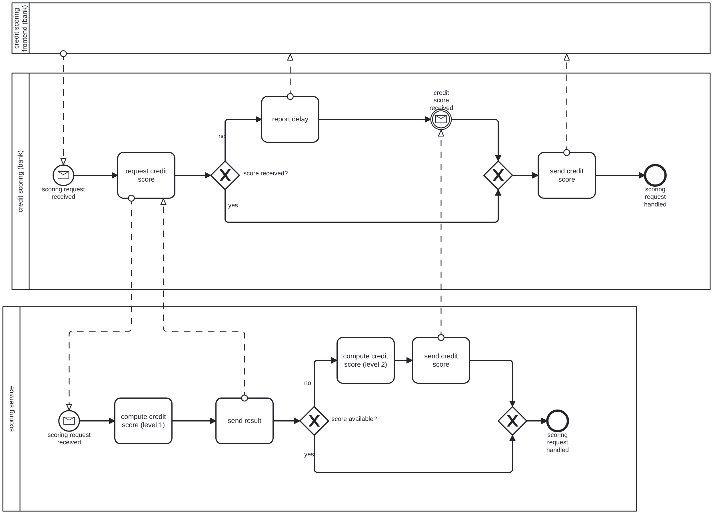
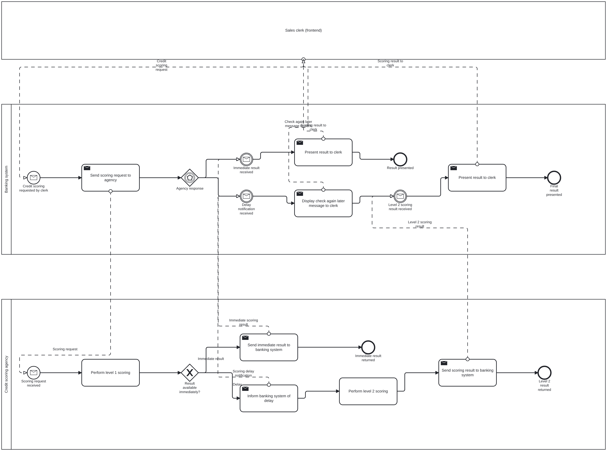
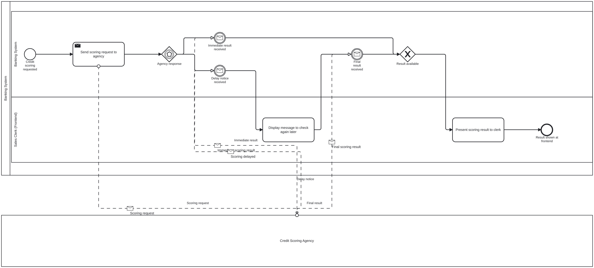
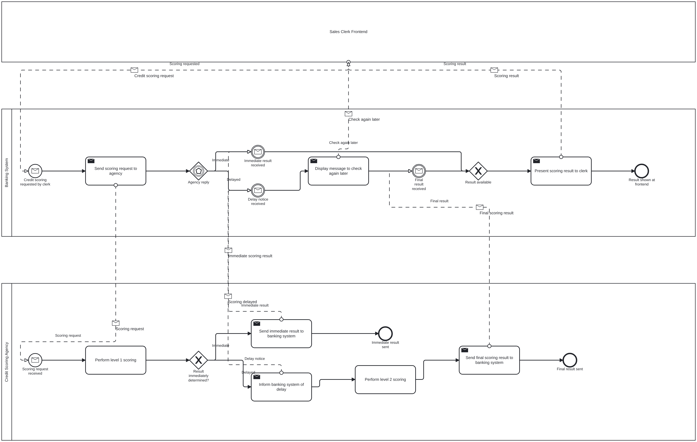
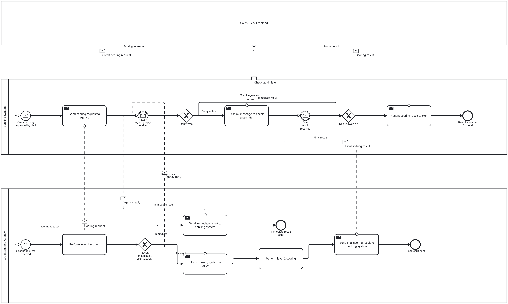
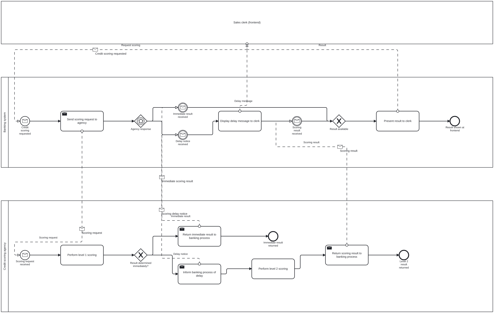

# Scenario 5: description 23 with Claude Haiku 5.5

**Description** (PMo dataset, id 23; reference model: 3 pools, 6 message flows):

> The sales clerks in a bank can use their software frontend to receive the credit-scoring for a certain customer. 
This starts a process in the banking system which communicates with the agency in the background. 
This process sends a scoring request to the agency right after the beginning. 
Then, the Agency does a first quick scoring (level 1). 
This will often lead to an immediate result which is then returned directly to the banking system within seconds. 
The banking process presents the result to the clerk sitting at the frontend. 
Sometimes the scoring cannot be determined immediately and takes longer. 
In this case the agency informs the banking process of the delay and then starts the level 2 scoring (which can take up to a couple of minutes). 
After the scoring result is determined, the information is sent back to the banking process. 
The banking process displays a message to the clerk when he receives information about the delay to check again later. 
As soon as the result arrives, it can be seen at the frontend.

This scenario follows the same description through the three settings of the paper. Each stage below
shows the model GuideBPMN generated, with its open errors (T1–T7, lower is better) and its similarity
to the reference model (in %, higher is better; Participants compares pools, lanes, lane membership and message flows).

| Stage | Errors | Activities F1 | Connections F1 | Flow order | Coverage | Participants |
|---|---|---|---|---|---|---|
| First (documentation guidelines only) | 48 | 62.5 | 17.6 | 35.5 | 45.0 | 17.6 |
| Revised: first draft (round 0) | 55 | 20.0 | 15.4 | 25.0 | 25.0 | 7.4 |
| Revised: iteration 1 | 42 | 66.7 | 23.5 | 43.1 | 52.6 | 26.7 |
| Revised: iteration 2 | 39 | 66.7 | 30.3 | 51.7 | 61.1 | 26.7 |
| Revised: iteration 3 (Learned) | 39 | 66.7 | 30.3 | 51.7 | 61.1 | 26.7 |
| Reuse (guidelines learned on other descriptions) | 46 | 53.3 | 23.5 | 47.4 | 47.4 | 18.8 |

## Reference model (gold BPMN of the dataset)

## First: documentation guidelines only

The generator receives the description and the 82 documentation guidelines. This is the First run
whose number of errors is the median of the three First runs (`batch_20261117T040628Z_anthropic-claude-haiku-5-5_documentation_r1`). Model: 3 pools, 8 message flows.

## Revised: three iterations with error-driven guidelines

Run `batch_20261117T232235Z_anthropic-claude-haiku-5-5_documentation_forced_r2_agents`. The run starts with its own first draft (55 errors). After each draft,
the guideline agents turn the detected errors into guidelines, and the generator revises the model with them.
The errors go from 55 to 42, 39 and 39.

**First draft** (55 errors; 2 pools, 4 message flows):

**Iteration 1** (42 errors):

**Iteration 2** (39 errors):

**Iteration 3, the Learned model** (39 errors; 3 pools, 7 message flows):

An iteration whose new model has more errors is not kept: the stage then shows the model kept before it.

### Guidelines learned on this description

**Learned after the first draft** (sent to iteration 1):

- **LRN-058** (T5, new generic guideline, new; confirmed: no): *When The description says an outside party, after receiving a request from the process, performs one or more processing steps of its own, possibly choosing a branch itself (for example announcing a delay before a further step), and then sends replies back to the process:* Model the outside party as its own bpmn:participant pool with its own start and end events. Put each of its described processing steps there as a bpmn:task, in the order the description gives, and show any branch the party chooses itself as an exclusive gateway inside its pool. Connect the requesting process to that pool with message flows: the request crosses to the party, and each notice or reply it sends crosses back. In the requesting process, keep the send of the request and an intermediate catch event for each awaited reply or notice, then add an exclusive gateway where the description says the process branches on which message arrived. Do not replace the party's own processing steps with catch events in the requesting process.
- **LRN-059** (T7, new generic guideline, refines COL-04; confirmed: yes): *When the description names an external party, such as another organization, a remote service, or a user-facing system, that exchanges messages with the process while the process runs:* Model each such external party as its own pool, not as a lane inside the process's pool. Show the exchanges with it as message flows between the pools: from the process's sending tasks to the external pool, and from the external pool to the process's receiving events or tasks. Do not draw these exchanges as sequence flows, and do not place the external party in a lane of the process pool.

**Learned after iteration 1** (sent to iteration 2):

- **LRN-044** (T5, consolidated with an existing guideline, refines EVT-03; confirmed: yes): *When The description states a step as work that a party performs, such as receiving an item or verifying a delivery, and the next described step follows it directly with no stated pause, timeout, or external occurrence being awaited:* Model that step as a task in the sequence, with the flow continuing straight to the next step. Do not replace it with an intermediate catch event. Use an intermediate catch event only where the description says the flow pauses until an external message, signal, time, or condition occurs.
- **EXS-044** (T6, new example-specific guideline, new; confirmed: no): *When the description says that an external party's answer to a request may either arrive at once or be delayed, so that the process must handle a notice of delay and later a final answer, with the outcome varying from case to case:* Model the external answer as a single decision point rather than as one catch event per outcome. After the request, model one wait for the external reply, followed by an exclusive gateway that routes an immediate final answer directly onward and a delay notice to a separate branch. In the delay branch, model a task performed by the process that reports the delay to the user, then an intermediate catch event that waits for the final answer, and then join that branch back with the immediate branch at an exclusive gateway before the answer is passed on. Each gateway outgoing flow must carry a condition that states which case it covers.
- **LRN-059** (T7, consolidated with an existing guideline, refines COL-04; confirmed: yes): *When the description names an external party, such as another organization, a remote service, or a user-facing system, that exchanges messages with the process while the process runs:* Model each such external party as its own pool, not as a lane inside the process's pool. Show the exchanges with it as message flows between the pools: from the process's sending tasks to the external pool, and from the external pool to the process's receiving events or tasks. Do not draw these exchanges as sequence flows, and do not place the external party in a lane of the process pool.

**Learned after iteration 2** (sent to iteration 3):

- **LRN-060** (T6, new generic guideline, refines ACT-01; confirmed: no): *When the description says that on an alternative branch an external party notifies the process of an interim status (such as a delay) and states that the final outcome will be produced and delivered afterwards, so the notification is a described action separate from the eventual delivery:* Model the interim notification as its own task on that alternative branch, placed after the decision that selects the branch and before the wait for the outcome. Do not merge it into the wait or the final delivery step. Keep the subsequent delivery of the outcome and any user-facing follow-up as separate elements after that wait.
- **EXS-047** (T7, new example-specific guideline, refines COL-01; confirmed: no): *When The description says a process sends a request to an outside service provider, the provider reports a delay to the process, and later sends back its final outcome to the process:* Model the outside service provider as its own pool. Model the process's request to the provider as a message flow into that pool. Model each notice the provider sends (such as a delay notice) and the final outcome as separate message flows from the provider's sending tasks or send events to the receiving events or tasks of the process. Do not connect the process and the provider with sequence flow, and do not leave these exchanges unmodeled.

## Reuse: guidelines learned on other descriptions

Run `batch_20261119T000252Z_anthropic-claude-haiku-5-5_documentation_learned_confirmed_fold2_agents` (cross-validation round 2). The generator received the documentation
guidelines and the 62 confirmed generic guidelines learned on the 44 descriptions of the
other four folds. The reference model of this description was not used. Errors: 46, fewer errors than First (48).

## Files

- `description.txt`: the process description.
- `0_reference.bpmn`: the reference model; `1_first.bpmn` to `6_reuse.bpmn`: the generated models.
  The generator does not write diagram positions; a layout was added to these copies so that they open in any
  BPMN editor (elements and flows are unchanged). The XML exactly as generated is in the run folder
  `bpmn_pipeline/runs/<run>/id_23/round_N/`.
- The `.png` files: the diagrams above.
