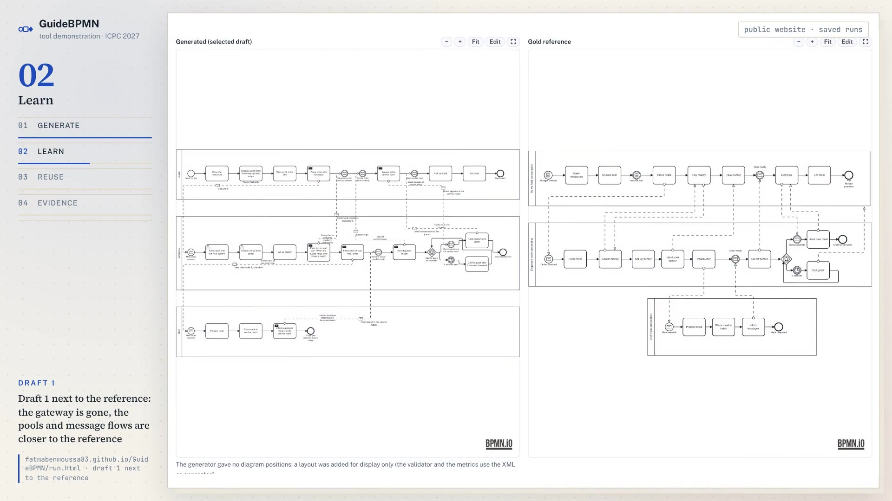

# GuideBPMN demonstration video (ICPC 2027 tool track)

[guidebpmn-demo.mp4](guidebpmn-demo.mp4): 4 min 45 s, 1920×1080, English voice-over and captions.

Every scene is the public website, <https://fatmabenmoussa83.github.io/GuideBPMN/>, in its saved-runs mode
(no API, no key): the pages read the 32 runs of the paper as they were saved in `docs/data/saved/`. The LLM
shown is GPT-6 Luna; the numbers of Claude Haiku 5.5 appear in the closing card. Nothing was edited in the
pages; the video only zooms on the parts it talks about.

| Part | What it shows | Open the same view |
|---|---|---|
| 01 Generate | Description 24 (a restaurant: guest, employee, chef). Draft 0, generated with the 82 documentation guidelines only, next to the reference. The validator fails level 3 (a gateway with one incoming and one outgoing flow); the similarity evaluator finds 34 discrepancies; 35 errors are open. | `run.html#run=batch_20261117T232222Z_openai-gpt-6-luna_documentation_forced_r1_agents&id=24`, button *draft 0* |
| 02 Learn | The orchestrator's decisions; the Retriever and Expert agents' tool calls; the guideline LRN-049 (refines ACT-07, generic); the four guidelines sent back; draft 1 valid with 30 open errors; LRN-049 and LRN-026 confirmed; iteration 2 not kept (40 errors against 30). The learned catalogue, with LRN-001 = (G01) of the paper. | same run and description, panels *Orchestrator*, *Guidelines*; `guidelines.html#learned`, catalogue "openai-gpt-6-luna · Revised run 1", search `LRN-001` |
| 03 Reuse | The five stratified folds; the Reuse test of round 2 (37 confirmed generic guidelines learned on 44 descriptions, 11 held out); description 23 (credit scoring, two pools): 51, 55 and 65 open errors in the First runs, 35 with the reused guidelines. | `run.html` (card *Run the experiment*, cross-validation); `run.html#run=batch_20261118T183956Z_openai-gpt-6-luna_documentation_learned_confirmed_fold2_agents&id=23`; `compare.html#luna/23`, tick *First r1* and *Reuse · fold 2* |
| 04 Evidence | All 55 descriptions (Learned vs First: 45 better, 9 worse; Reuse vs First: 31 better, 20 worse); the study table (Tables I–III of the paper, Wilcoxon tests); the replication package. | `compare.html#luna/24` (table *All 55 descriptions*); `run.html`, card *Study results*, GPT-6 Luna |

Numbers in the video and where they come from:

- Description 24, Luna Revised r1: draft 0 errors T3 1, T5 21, T6 4, T7 9 (35); after iteration 1: T5 15, T6 4, T7 11 (30), valid; LRN-049 (T3 1→0) and LRN-026 (T5 21→15) confirmed; iteration 2 draft reverted (40 errors against 30) — `bpmn_pipeline/runs/batch_20261117T232222Z_openai-gpt-6-luna_documentation_forced_r1_agents/id_24/`.
- LRN-049, LRN-026, LRN-001 — `guidelines/learned/openai-gpt-6-luna/agents/replicates/r1/learned_guidelines.md`.
- Round 2, Luna: 37 confirmed generic guidelines — `guidelines/learned/openai-gpt-6-luna/agents/folds/fold_2/`.
- Description 23, Luna: First 51 / 55 / 65 errors, Reuse 35 (valid) — `docs/data/saved/compare/openai-gpt-6-luna.json.gz`, or the Compare page.
- 44.6 → 38.4 and 43.0 → 36.0 open errors (−13.8 % / −16.3 %), 45 / 48 descriptions improved, −5.6 % / −4.3 % in Reuse — `bpmn_pipeline/runs/_study_reports/`, the study table of the Run page, and the paper.

To rerun any description from zero, start the local API (`.\start_webapi.ps1`) and use the card *Test one description from zero* of the Run page.
